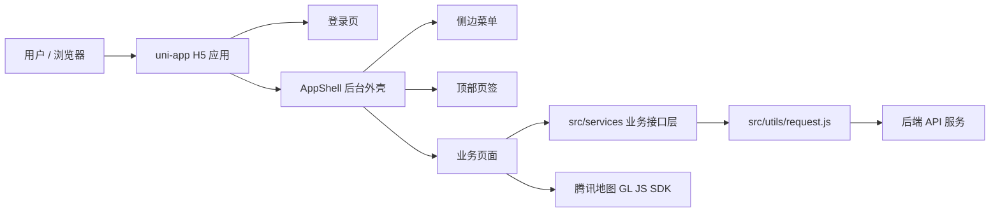
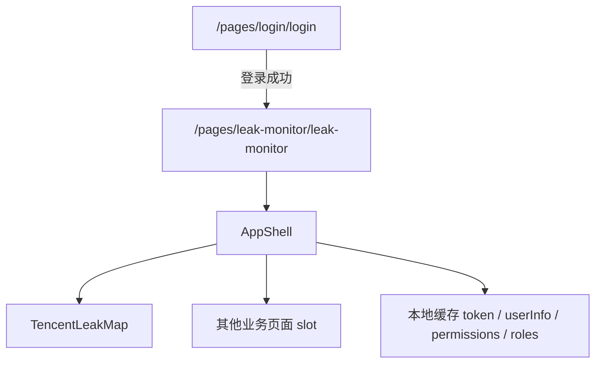

# 城市管网渗漏预警平台

城市管网渗漏预警平台前端工程，基于 `uni-app`、`Vue 3`、`TypeScript` 和 `Vite 5` 构建。项目当前以 H5 后台管理端为主，同时保留微信、支付宝、百度、QQ、头条、小红书等多端小程序构建脚本，方便后续按终端形态扩展。

系统围绕城市管网渗漏业务展开，覆盖渗漏监测、分区管理、设备管理、数据分析、疑漏点上报、统计分析、工单管理、实时报警、统计报表、系统设置、数据接收和解析等模块。登录后统一进入后台应用外壳，默认展示“渗漏监测”页面。

## 目录

- [项目定位](#项目定位)
- [技术架构](#技术架构)
- [快速开始](#快速开始)
- [环境和接口地址](#环境和接口地址)
- [目录结构](#目录结构)
- [页面和路由](#页面和路由)
- [接口模块](#接口模块)
- [核心实现说明](#核心实现说明)
- [样式和资源](#样式和资源)
- [开发流程](#开发流程)
- [提交前检查](#提交前检查)
- [常见问题](#常见问题)

## 项目定位

本项目是城市管网渗漏预警平台的前端管理端，主要承担：

- 用户登录、注册、登录态保存和权限信息缓存。
- 后台管理端通用布局，包括顶部栏、侧边菜单、页面页签、内容区和退出登录。
- 管网渗漏地图监测入口。
- 分区、设备、报警、工单、报表、系统配置等业务模块页面承载。
- 后端 API 的前端 service 封装。
- H5 和多端小程序工程结构维护。

当前业务页面多数已经完成路由、外壳、接口服务和页面骨架，后续开发应在既有模块和 service 基础上补充真实业务交互。

## 技术架构

### 总体架构



### 技术栈

| 层级 | 技术 | 说明 |
| --- | --- | --- |
| 应用框架 | `uni-app` | 统一 H5 和多端小程序目录、生命周期、路由和构建能力 |
| UI 框架 | `Vue 3` | 使用 `<script setup>` 和 Composition API |
| 类型系统 | `TypeScript` | 页面、组件、声明文件使用 TS；部分 service 仍为 JS |
| 构建工具 | `Vite 5` | 由 `@dcloudio/vite-plugin-uni` 接入 uni-app |
| 样式方案 | `SCSS` | 页面 scoped 样式为主，全局变量和 mixin 由 Vite 注入 |
| 请求层 | `uni.request` | 通过 `src/utils/request.js` 封装统一请求入口 |
| 地图能力 | 腾讯地图 GL JS SDK | 渗漏监测组件运行时懒加载 |
| 包管理 | `npm` | 使用 `package-lock.json` 锁定依赖版本 |

### 分层说明

| 层级 | 目录 / 文件 | 职责 |
| --- | --- | --- |
| 应用入口 | `src/main.ts`、`src/App.vue` | 创建应用实例，承载 uni-app 根组件 |
| 路由配置 | `src/pages.json` | 注册页面路由、页面标题和自定义导航 |
| 后台外壳 | `src/components/AppShell.vue` | 登录后统一布局、菜单、页签、默认页面和退出登录 |
| 页面层 | `src/pages/**` | 业务页面、页面组件和页面样式 |
| 接口层 | `src/services/**` | 按业务模块封装后端 API |
| 请求基础层 | `src/utils/request.js` | 基础地址、认证头、错误标准化、请求发起 |
| 样式基础层 | `src/styles/**`、`src/uni.scss` | 全局样式、变量、mixin 和 uni 样式变量 |
| 静态资源 | `src/assets/**` | 背景图、logo 等静态资源 |

### 登录后页面运行关系



未登录状态直接访问登录后页面时，`AppShell` 会通过 `src/utils/authGuard.js` 清理本地登录态并跳回 `/pages/login/login`，避免只显示后台外壳或首页内容。

## 快速开始

### 安装依赖

```bash
npm install
```

### 启动 H5

```bash
npm run dev:h5
```

H5 开发服务默认从 `5173` 开始分配端口，若端口被占用会自动顺延。以终端输出的 `Local` 地址为准。

### 常用脚本

| 命令 | 说明 |
| --- | --- |
| `npm run dev:h5` | 启动 H5 本地开发服务 |
| `npm run build:h5` | 构建 H5 生产产物 |
| `npm run type-check` | 执行 Vue 和 TypeScript 类型检查 |
| `npm run check` | 先类型检查，再执行 H5 构建 |
| `npm run dev:mp-weixin` | 微信小程序开发构建 |
| `npm run build:mp-weixin` | 微信小程序生产构建 |
| `npm run dev:mp-alipay` | 支付宝小程序开发构建 |
| `npm run build:mp-alipay` | 支付宝小程序生产构建 |

其他平台脚本可在 `package.json` 中查看，包括百度、京东、快手、QQ、头条、小红书等平台。

## 环境和接口地址

接口基础地址由 `src/utils/request.js` 统一处理。

| 配置 | 说明 |
| --- | --- |
| 默认后端地址 | 同源相对 `/api` |
| 环境变量 | `VITE_API_BASE_URL`、`VITE_DEV_PROXY_TARGET` |
| 开发代理 | `vite.config.ts` 中 `/api` 默认代理到 `http://127.0.0.1:28082` |
| 请求超时 | 默认 `15000ms` |
| 认证头 | 自动读取本地缓存中的 `token` 和 `tokenPrefix` |

示例：

```bash
VITE_DEV_PROXY_TARGET=http://127.0.0.1:28082 npm run dev:h5
```

登录成功后写入本地缓存：

| Key | 来源 | 用途 |
| --- | --- | --- |
| `token` | 登录接口返回 | 后续请求认证 |
| `tokenPrefix` | 登录接口返回 | 拼接 `Authorization` 前缀 |
| `userInfo` | 登录接口返回 | 顶部用户信息展示 |
| `permissions` | 登录接口返回 | 权限数据缓存 |
| `roles` | 登录接口返回 | 角色数据缓存 |
| `rememberLoginAccount` | 登录页记住账号功能 | 回填登录账号和密码 |
| `sideMenuCollapsed` | 后台外壳 | 记忆侧边栏折叠状态 |

## 目录结构

### 根目录

| 路径 | 说明 |
| --- | --- |
| `src/` | 前端源码目录 |
| `dist/` | 构建输出目录，提交时通常不应纳入版本控制 |
| `index.html` | H5 入口 HTML |
| `package.json` | 依赖、脚本和项目信息 |
| `package-lock.json` | npm 依赖锁定文件 |
| `tsconfig.json` | TypeScript 配置 |
| `vite.config.ts` | Vite 和 uni-app 插件配置 |
| `Dockerfile` | 容器化部署配置 |
| `README.md` | 项目说明文档 |

### `src` 目录

| 路径 | 说明 |
| --- | --- |
| `src/assets/images/` | 背景图、logo 等图片资源 |
| `src/components/AppShell.vue` | 登录后后台外壳，维护顶部栏、侧边栏、页签和内容区 |
| `src/pages/` | 页面目录，按业务模块分组 |
| `src/services/` | 接口请求服务，按业务模块分组 |
| `src/styles/global.scss` | 全局样式 |
| `src/styles/variables.scss` | 全局 SCSS 变量 |
| `src/styles/mixins.scss` | 全局 SCSS mixin |
| `src/utils/request.js` | 统一请求封装 |
| `src/App.vue` | 应用根组件 |
| `src/main.ts` | 应用入口 |
| `src/pages.json` | uni-app 页面路由配置 |
| `src/manifest.json` | uni-app 应用配置 |
| `src/uni.scss` | uni-app 样式变量 |
| `src/env.d.ts`、`src/shims-uni.d.ts` | 类型声明 |
| `src/auto-imports.d.ts` | 自动导入类型声明 |

### `src/pages` 模块结构

| 目录 | 模块 | 说明 |
| --- | --- | --- |
| `login` | 登录注册 | 登录、注册、记住账号、登录态保存 |
| `index` | 首页入口 | 我的收藏或后台首页入口 |
| `leak-monitor` | 渗漏监测 | 地图监测页面和腾讯地图组件 |
| `station` | 分区管理 | 管网分区、部门等基础资源 |
| `device` | 设备管理 | 设备信息、拆装维护、设备状态 |
| `data-analysis` | 数据分析 | 系统总览、音频、设备参数、渗漏数据 |
| `leak-report` | 疑漏点上报 | 疑点、漏点、处理、分析和历史 |
| `statistics` | 统计分析 | 设备、渗漏、工单、报警等统计 |
| `work-order` | 工单管理 | 工单创建、处理、查询与统计 |
| `alarm` | 实时报警 | 报警策略、处理、分析 |
| `report` | 统计报表 | 报表生成、操作、指令管理 |
| `system` | 系统设置 | 用户、权限、菜单、字典 |
| `data-receive` | 数据接收和解析 | 协议管理、解析规则、数据记录 |

### `src/services` 模块结构

| 目录 | 模块 | 说明 |
| --- | --- | --- |
| `shared` | 通用请求能力 | GET、POST、PUT、DELETE 和 CRUD 工厂 |
| `user` | 用户服务 | 登录、注册、用户 CRUD、角色分配、密码更新 |
| `leak-monitor` | 渗漏监测 | 地图相关设备、管网、漏点、音频、算法结果 |
| `station` | 分区管理 | 管网分区、部门 |
| `device` | 设备管理 | 设备、产品、协议、维护、状态 |
| `data-analysis` | 数据分析 | 总览、音频、设备参数、渗漏数据 |
| `leak-report` | 疑漏点上报 | 疑点、漏点、分析、历史、处理动作 |
| `statistics` | 统计分析 | 平台级汇总统计 |
| `work-order` | 工单管理 | 工单创建、处理、统计、导出 |
| `alarm` | 实时报警 | 报警策略、报警记录、确认、忽略、转工单 |
| `report` | 统计报表 | 报表模板、任务、报表、指令、固件 |
| `system` | 系统设置 | 用户、角色、权限、菜单、字典 |
| `data-receive` | 数据接收和解析 | 协议、字段、解析记录、采样记录 |

## 页面和路由

页面路由统一配置在 `src/pages.json`。后台菜单统一配置在 `src/components/AppShell.vue`。

路径规则：

- `pages.json` 中的 `path` 不带开头斜杠，例如 `pages/leak-monitor/leak-monitor`
- `AppShell.vue` 菜单中的 `path` 带开头斜杠，例如 `/pages/leak-monitor/leak-monitor`

### 顶层和独立页面

| 页面 | 路由 | 页面文件 | 说明 |
| --- | --- | --- | --- |
| 登录 / 注册 | `/pages/login/login` | `src/pages/login/login.vue` | 用户登录、注册、表单校验、记住账号、登录态保存 |
| 管网首页 / 我的收藏 | `/pages/index/index` | `src/pages/index/index.vue` | 首页入口，当前可作为收藏和常用功能承载页 |
| 渗漏监测 | `/pages/leak-monitor/leak-monitor` | `src/pages/leak-monitor/leak-monitor.vue` | 登录后的默认页面，承载腾讯地图监测组件 |
| 分区管理 | `/pages/partition/partition` | `src/pages/partition/partition.vue` | 管网分区、部门等基础资源管理 |
| 统计分析 | `/pages/statistics/statistics` | `src/pages/statistics/statistics.vue` | 平台级数据统计页面 |

### 渗漏监测

| 页面 / 组件 | 路由 | 文件 | 说明 |
| --- | --- | --- | --- |
| 渗漏监测页面 | `/pages/leak-monitor/leak-monitor` | `src/pages/leak-monitor/leak-monitor.vue` | 使用 `AppShell` 包裹，渲染地图组件 |
| 腾讯地图组件 | 无独立路由 | `src/pages/leak-monitor/components/TencentLeakMap.vue` | 懒加载腾讯地图 GL JS SDK，初始化地图和中心标记 |

### 设备管理

| 页面 | 路由 | 文件 | 说明 |
| --- | --- | --- | --- |
| 设备信息 | `/pages/device/info/info` | `src/pages/device/info/info.vue` | 设备档案、设备产品、设备协议绑定 |
| 拆装维护 | `/pages/device/maintenance/maintenance` | `src/pages/device/maintenance/maintenance.vue` | 设备安装、拆除、维修、保养等维护记录 |
| 设备状态 | `/pages/device/status/status` | `src/pages/device/status/status.vue` | 设备状态、状态上报、设备日数据 |

### 数据分析

| 页面 | 路由 | 文件 | 说明 |
| --- | --- | --- | --- |
| 系统总览 | `/pages/data-analysis/overview/overview` | `src/pages/data-analysis/overview/overview.vue` | 系统、设备、渗漏、工单、报警等总览数据 |
| 音频数据 | `/pages/data-analysis/audio/audio` | `src/pages/data-analysis/audio/audio.vue` | 采样音频和采样明细分析 |
| 设备参数 | `/pages/data-analysis/device-params/device-params` | `src/pages/data-analysis/device-params/device-params.vue` | 设备设置、设备日数据、设备状态上报 |
| 渗漏数据 | `/pages/data-analysis/leakage/leakage` | `src/pages/data-analysis/leakage/leakage.vue` | 渗漏记录和算法结果分析 |

### 疑漏点上报

| 页面 | 路由 | 文件 | 说明 |
| --- | --- | --- | --- |
| 疑点管理 | `/pages/leak-report/suspect-management/suspect-management` | `src/pages/leak-report/suspect-management/suspect-management.vue` | 疑似漏点分页、详情、创建、更新、删除 |
| 疑点处理 | `/pages/leak-report/suspect-processing/suspect-processing` | `src/pages/leak-report/suspect-processing/suspect-processing.vue` | 疑点分配、确认、排除、转工单 |
| 漏点管理 | `/pages/leak-report/leak-management/leak-management` | `src/pages/leak-report/leak-management/leak-management.vue` | 已确认漏点管理 |
| 漏点分析 | `/pages/leak-report/leak-analysis/leak-analysis` | `src/pages/leak-report/leak-analysis/leak-analysis.vue` | 漏点趋势、分布、修复统计和算法结果 |
| 历史总览 | `/pages/leak-report/history-overview/history-overview` | `src/pages/leak-report/history-overview/history-overview.vue` | 疑点和漏点历史分页、详情 |

### 工单管理

| 页面 | 路由 | 文件 | 说明 |
| --- | --- | --- | --- |
| 工单创建 | `/pages/work-order/create/create` | `src/pages/work-order/create/create.vue` | 创建工单和查询工单基础信息 |
| 工单处理 | `/pages/work-order/processing/processing` | `src/pages/work-order/processing/processing.vue` | 工单详情、更新、分派、催办、关闭 |
| 工单查询与统计 | `/pages/work-order/statistics/statistics` | `src/pages/work-order/statistics/statistics.vue` | 工单分页、列表、统计、导出 |

### 实时报警

| 页面 | 路由 | 文件 | 说明 |
| --- | --- | --- | --- |
| 报警策略 | `/pages/alarm/strategy/strategy` | `src/pages/alarm/strategy/strategy.vue` | 报警策略 CRUD |
| 报警处理 | `/pages/alarm/processing/processing` | `src/pages/alarm/processing/processing.vue` | 报警记录、确认、忽略、转工单 |
| 报警分析 | `/pages/alarm/analysis/analysis` | `src/pages/alarm/analysis/analysis.vue` | 报警统计、趋势、导出 |

### 统计报表

| 页面 | 路由 | 文件 | 说明 |
| --- | --- | --- | --- |
| 报表生成 | `/pages/report/generate/generate` | `src/pages/report/generate/generate.vue` | 报表模板、生成任务、生成动作 |
| 报表操作 | `/pages/report/operation/operation` | `src/pages/report/operation/operation.vue` | 报表查询、删除、导出、打印 |
| 指令管理 | `/pages/report/command/command` | `src/pages/report/command/command.vue` | 指令字典、参数、下发记录、固件、升级 |

### 系统设置

| 页面 | 路由 | 文件 | 说明 |
| --- | --- | --- | --- |
| 用户配置 | `/pages/system/user/user` | `src/pages/system/user/user.vue` | 用户 CRUD、角色分配、密码更新 |
| 权限管理 | `/pages/system/auth/auth` | `src/pages/system/auth/auth.vue` | 角色、权限、权限树、角色授权 |
| 菜单管理 | `/pages/system/menu/menu` | `src/pages/system/menu/menu.vue` | 基于权限资源维护菜单树 |
| 数据字典 | `/pages/system/dict/dict` | `src/pages/system/dict/dict.vue` | 字典类型和字典项管理 |

### 数据接收和解析

| 页面 | 路由 | 文件 | 说明 |
| --- | --- | --- | --- |
| 协议管理 | `/pages/data-receive/access/access` | `src/pages/data-receive/access/access.vue` | 协议定义、设备协议绑定、JSON 文件导入协议内容 |
| 数据解析 | `/pages/data-receive/parse/parse` | `src/pages/data-receive/parse/parse.vue` | 协议字段、解析记录、字段批量保存 |
| 数据记录 | `/pages/data-receive/record/record` | `src/pages/data-receive/record/record.vue` | 采样记录、明细、日报、压力、CSS 采样数据 |

## 接口模块

### 请求封装

统一请求入口：`src/utils/request.js`

| 能力 | 说明 |
| --- | --- |
| 基础地址 | 优先读取 `VITE_API_BASE_URL`，否则使用同源相对 `/api` |
| URL 标准化 | 支持完整 URL，也支持 `/api/user/login` 等相对路径 |
| 认证头 | 自动读取 `token` 和 `tokenPrefix`，拼入 `Authorization` |
| 超时 | 默认 `15000ms` |
| 错误处理 | HTTP 非 2xx 和网络错误统一 reject 为 `{ code, msg, data }` |

通用 CRUD 工厂：`src/services/shared/crud.js`

| 方法 | HTTP | 默认路径 | 用途 |
| --- | --- | --- | --- |
| `getDetail(id)` | `GET` | `/resource/:id` | 详情 |
| `create(data)` | `POST` | `/resource/create` | 新增 |
| `update(id, data)` | `PUT` | `/resource/:id` | 更新 |
| `delete(id)` | `DELETE` | `/resource/:id` | 删除 |
| `getPage(data)` | `POST` | `/resource/page` | 分页 |
| `getList(params)` | `GET` | `/resource/list` | 列表 |
| `batchDelete(data)` | `DELETE` | `/resource/batch-delete` | 批量删除 |

### Service 详细清单

| 模块 | 文件 | 主要资源 / 接口 | 主要能力 |
| --- | --- | --- | --- |
| 用户服务 | `services/user/user.js` | `/api/user/login`、`/api/user/register`、`/api/user` | 登录、注册、用户 CRUD、批删、角色分配、密码更新 |
| 系统用户 | `services/system/user.js` | 复用 `services/user/user.js` | 系统设置里的用户配置能力 |
| 渗漏监测 | `services/leak-monitor/leak-monitor.js` | `/api/device`、`/api/tube-network`、`/api/leakage-record`、`/api/sampling-audio`、`/api/sampling-detail`、`/api/algorithm-result` | 地图设备、管网、渗漏记录、音频、采样明细、算法结果 |
| 分区管理 | `services/partition/partition.js` | `/api/tube-network`、`/api/dept` | 分区、管网、部门接口；当前分区候选复用部门接口 |
| 设备信息 | `services/device/info.js` | `/api/device`、`/api/device-product`、`/api/device-protocol-relation` | 设备、产品、协议绑定、按设备/协议查询 |
| 拆装维护 | `services/device/maintenance.js` | `/api/maintenance-record` | 维护记录 CRUD |
| 设备状态 | `services/device/status.js` | `/api/device`、`/api/device-status-upload`、`/api/device-daily-data` | 设备状态、状态上报、设备日数据 |
| 系统总览 | `services/data-analysis/overview.js` | 暂无 | `jiekou` 暂未提供总览统计接口，service 暂不封装请求 |
| 音频数据 | `services/data-analysis/audio.js` | `/api/sampling-audio`、`/api/sampling-detail` | 采样音频和明细 |
| 设备参数 | `services/data-analysis/device-params.js` | `/api/device-setting`、`/api/device-daily-data`、`/api/device-status-upload` | 设备设置、日数据、状态上报 |
| 渗漏数据 | `services/data-analysis/leakage.js` | `/api/leakage-record`、`/api/algorithm-result` | 渗漏记录、算法结果 |
| 疑点管理 | `services/leak-report/suspect-management.js` | `/api/leakage-record` | `jiekou` 暂未提供疑点接口，当前仅保留漏点关联查询 |
| 疑点处理 | `services/leak-report/suspect-processing.js` | 暂无 | `jiekou` 暂未提供疑点处理接口，service 暂不封装请求 |
| 漏点管理 | `services/leak-report/leak-management.js` | `/api/leakage-record` | 漏点记录 CRUD |
| 漏点分析 | `services/leak-report/leak-analysis.js` | `/api/leakage-record`、`/api/algorithm-result` | 渗漏记录和算法分析结果查询 |
| 历史总览 | `services/leak-report/history-overview.js` | `/api/leakage-record` | 漏点历史查询；`jiekou` 暂未提供疑点历史接口 |
| 统计分析 | `services/statistics/statistics.js` | 暂无 | `jiekou` 暂未提供统计分析接口，service 暂不封装请求 |
| 工单创建 | `services/work-order/create.js` | `/api/worksheet` | 创建工单、工单分页/列表/详情 |
| 工单处理 | `services/work-order/processing.js` | `/api/worksheet` | 工单详情和更新；`jiekou` 暂未提供分派、催办、关闭接口 |
| 工单统计 | `services/work-order/statistics.js` | `/api/worksheet` | 工单分页和列表；`jiekou` 暂未提供统计、导出接口 |
| 报警策略 | `services/alarm/strategy.js` | 暂无 | `jiekou` 暂未提供报警策略接口，service 暂不封装请求 |
| 报警处理 | `services/alarm/processing.js` | 暂无 | `jiekou` 暂未提供报警记录接口，service 暂不封装请求 |
| 报警分析 | `services/alarm/analysis.js` | 暂无 | `jiekou` 暂未提供报警分析接口，service 暂不封装请求 |
| 报表生成 | `services/report/generate.js` | 暂无 | `jiekou` 暂未提供报表生成接口，service 暂不封装请求 |
| 报表操作 | `services/report/operation.js` | 暂无 | `jiekou` 暂未提供报表操作接口，service 暂不封装请求 |
| 指令管理 | `services/report/command.js` | `/api/command-dict`、`/api/command-param`、`/api/command-send-log`、`/api/firmware`、`/api/firmware-upgrade-log` | 指令字典、参数、下发记录、固件、升级记录 |
| 权限管理 | `services/system/auth.js` | `/api/role`、`/api/permission`、`/api/permission/tree`、`/api/role/:id/permissions` | 角色、权限、权限树、角色授权 |
| 菜单管理 | `services/system/menu.js` | `/api/permission`、`/api/permission/tree` | 菜单和权限树 |
| 数据字典 | `services/system/dict.js` | `/api/dict-type`、`/api/dict-item` | 字典类型和字典项 |
| 数据接入 | `services/data-receive/access.js` | `/api/protocol-definition`、`/api/device-protocol-relation`、`/by-device`、`/by-protocol` | 协议定义、设备协议关系；协议 JSON 导入复用协议定义新增接口提交到后端 |
| 数据解析 | `services/data-receive/parse.js` | `/api/protocol-field-definition`、`/api/protocol-parse-record`、`/by-protocol` | 协议字段、解析记录、字段逐条保存 |
| 数据记录 | `services/data-receive/record.js` | `/api/sampling-record`、`/api/sampling-detail`、`/api/sampling-daily`、`/api/sampling-pressure`、`/api/sampling-css-data` | 采样记录、明细、日报、压力、CSS 数据 |

## 核心实现说明

### 登录页

相关文件：

| 文件 | 说明 |
| --- | --- |
| `src/pages/login/login.vue` | 登录/注册模板和逻辑 |
| `src/pages/login/login.scss` | 登录页样式 |
| `src/services/user/user.js` | 登录、注册和用户接口 |
| `src/services/user/user.d.ts` | 用户接口类型声明 |

关键点：

- `activeMode` 控制登录和注册模式。
- `loginForm` 保存登录表单，`registerForm` 保存注册表单。
- 登录成功后保存 token、用户、权限、角色信息。
- 登录成功后跳转 `/pages/leak-monitor/leak-monitor`。
- 支持记住账号与密码，缓存 key 为 `rememberLoginAccount`。
- 注册字段中真实姓名、手机号、邮箱为选填项。

### 后台外壳 `AppShell`

相关文件：`src/components/AppShell.vue`

| 能力 | 说明 |
| --- | --- |
| 顶部栏 | 平台标题、分区搜索、预警入口、用户信息、退出登录 |
| 侧边菜单 | 支持多级菜单、折叠态、折叠浮层 |
| 页面页签 | 打开、激活、关闭、滚动到当前页签 |
| 默认页面 | 默认进入渗漏监测，全部页签关闭后回到渗漏监测 |
| H5 路径同步 | 使用浏览器路径、hash、history 同步当前页面 |
| 内容区全屏 | 后台内容区全屏能力和退化方案 |

维护注意：

- 菜单 `path` 必须和 `pages.json` 注册页面一致。
- 菜单 `icon` 必须和样式中的 `side-menu__icon--xxx`、`page-tab__icon--xxx` 对应。
- 新增页面时，需要同步页面文件、`pages.json`、`AppShell.vue` 菜单。

### 渗漏监测地图

相关文件：

| 文件 | 说明 |
| --- | --- |
| `src/pages/leak-monitor/leak-monitor.vue` | 页面入口，使用 `AppShell` 承载 |
| `src/pages/leak-monitor/components/TencentLeakMap.vue` | 腾讯地图 GL JS SDK 懒加载和地图初始化 |
| `src/services/leak-monitor/leak-monitor.js` | 地图业务数据接口服务 |

当前地图默认中心点为上海坐标。后续接入真实站点、设备或漏点时，应优先通过 `services/leak-monitor/leak-monitor.js` 获取数据，不要在地图组件中继续硬编码业务点位。

## 样式和资源

### 样式入口

| 文件 | 说明 |
| --- | --- |
| `src/styles/global.scss` | 全局基础样式 |
| `src/styles/variables.scss` | 全局变量 |
| `src/styles/mixins.scss` | 全局 mixin |
| `src/uni.scss` | uni-app 样式变量 |
| 页面同目录 `.scss` | 页面局部样式，例如 `login/login.scss` |

`vite.config.ts` 中已配置：

```ts
scss: {
  additionalData: '@use "@/styles/variables.scss" as *;\n@use "@/styles/mixins.scss" as *;\n',
}
```

因此页面 SCSS 中可以直接使用全局变量和 mixin。

### 资源

| 路径 | 说明 |
| --- | --- |
| `src/assets/images/background.webp` | 登录页背景图 |
| `src/assets/images/logo.webp` | 登录页和顶部栏 logo |

## 开发流程

### 新增页面

1. 在 `src/pages/<module>/<page>/<page>.vue` 创建页面。
2. 在 `src/pages.json` 注册路由。
3. 如需后台菜单入口，在 `src/components/AppShell.vue` 的 `menuItems` 中新增配置。
4. 如需请求后端，在 `src/services/<module>` 下新增或复用 service。
5. 运行 `npm run type-check`，涉及构建风险时运行 `npm run build:h5`。

登录后页面推荐结构：

```vue
<template>
  <AppShell>
    <view class="content-page"></view>
  </AppShell>
</template>

<script setup lang="ts">
import AppShell from "@/components/AppShell.vue";
</script>
```

### 新增接口

1. 判断接口归属业务模块。
2. REST 风格资源优先使用 `createCrudService("/api/resource")`。
3. 动作类接口使用 `getRequest`、`postRequest` 等语义方法封装。
4. 页面层只调用 service 方法，不直接拼接 URL。
5. 复杂返回结构优先补类型声明。

### 修改登录流程

关注点：

- `TOKEN_KEY` 和 `TOKEN_PREFIX_KEY` 来自 `src/utils/request.js`。
- 登录后页面需要经由 `src/utils/authGuard.js` 判断本地 token；未登录直达受保护页面时回到 `/pages/login/login`。
- 登录成功后的默认地址应保持为 `/pages/leak-monitor/leak-monitor`。
- 退出登录需要清理 token、用户信息、权限和角色缓存。
- 登录页同时包含登录和注册模式，表单样式和提示要兼顾两种状态。

### 修改 AppShell 菜单

关注点：

- 菜单 label、path、icon、children 要成组维护。
- 子菜单的 path 必须已在 `pages.json` 注册。
- icon 需要有对应 CSS mask 样式。
- 默认页面逻辑由 `DEFAULT_PAGE_PATH` 控制。

## 提交前检查

建议提交前执行：

```bash
npm run type-check
npm run build:h5
```

或：

```bash
npm run check
```

提交前确认：

- `git status --short` 中没有无关文件。
- 未提交 `dist/`、临时目录、IDE 本地配置。
- 新页面已同步页面文件、`pages.json`、菜单配置。
- 新接口已放入对应 service，不在页面中直接拼 URL。
- 登录态、默认页、页签关闭后的兜底逻辑符合预期。

## 常见问题

### 本地启动端口不是 5173

Vite 会在端口占用时自动顺延，以终端输出的 `Local` 地址为准。

### 请求地址不对

先检查是否设置了 `VITE_API_BASE_URL` 或 `VITE_DEV_PROXY_TARGET`。未设置 `VITE_API_BASE_URL` 时会使用同源相对 `/api`，开发代理配置在 `vite.config.ts`。

### 登录后没有进入渗漏监测

检查：

- 登录成功后的 `uni.reLaunch` 地址。
- `AppShell.vue` 中 `DEFAULT_PAGE_PATH`。
- H5 浏览器路径同步逻辑是否被修改。

### 新页面打不开

通常是以下原因：

- 页面文件路径不正确。
- `src/pages.json` 未注册。
- `AppShell.vue` 菜单 path 和 `pages.json` 不一致。
- 页面没有使用 `AppShell` 承载登录后布局。

### 地图加载失败

优先检查：

- 腾讯地图 Key 是否有效。
- Web 端域名白名单是否包含当前访问域名。
- 当前是否在 H5 端运行。
- 浏览器网络是否能访问腾讯地图 SDK。
